# Verity

**Pre-publication brand-compliance gate.** A brand stores its source of truth once: versioned rules, a Fact Registry and its visual identity. Verity checks every draft (text and images) against that source before it goes live. Every issue cites the rule or fact it breaks and comes with a suggested fix. A creator decides on each issue, and a manager approves.

> **No source, no hard flag.** If the AI can't cite a rule or fact that was actually retrieved for this check, or isn't confident, the finding is downgraded to `needs_human_verification` and capped at medium severity.

- **Live demo:** https://verity-eight-lemon.vercel.app (no sign-in needed)
- **Code:** https://github.com/notaditya28/verity-
- **Demo brand:** "Lumina Skin", a fictional Indian skincare brand.
- Built for CodeZen India 2026 Round 2 by team codzilla.

## Try it in 60 seconds
1. Open the app and go to **Submit**. Click a sample on the right, e.g. **1. Hype influencer post**, then **Check content**.
2. On the results page each finding shows its rule (e.g. `C-03`), the fact it contradicts (e.g. `F-12: ₹449`), the quoted evidence and a suggested fix. Highlights in the text are coloured by severity.
3. As the **Creator**, click **Accept all fixes**, then **Apply accepted fixes → v2**. Verity builds v2, re-checks it and shows a word-level diff. v2 comes back clean.
4. Click **Submit for review**. Switch to **Manager** in the header, open **Review** and **Approve**, **Request changes** or **Escalate to Legal**.
5. Try **4. Ad image (off-palette)** for images: Verity reads the text in the banner, catches the wrong price (₹399 vs ₹449), measures the yellow-on-orange contrast (about 1.7:1, needs 4.5:1), flags the off-palette orange and the missing alt text.
6. On **Brand**, a Manager can edit a fact (e.g. change F-12's price). This creates a new policy version, and new checks use the new value. Everything is in the **Audit** log.

**Reset demo** in the header restores the seed data at any time.

## How a check works

```mermaid
flowchart TD
    A[Creator submits text / image + goal, audience, CTA] --> B[API route: zod-validated input]
    B --> I{Image?}
    I -- yes --> V[Gemini vision, once per version:<br/>text, description, text boxes]
    V --> P[sharp + node-vibrant:<br/>dominant colours, pixel contrast per text box]
    I -- no --> D
    P --> D[Deterministic rules - no LLM:<br/>terms, tone, superlatives, guarantees,<br/>prices/numbers vs Fact Registry, clinical,<br/>ASCI disclosure and medical claims, delivery,<br/>readability, alt text, WCAG contrast, CIEDE2000 palette]
    D --> S[(Save rule findings first)]
    S --> R[PII redaction then retrieval:<br/>Postgres full-text search + pg_trgm over rules and current facts]
    R --> J[Gemini judge: temperature 0, JSON schema,<br/>untrusted content in its own delimited block]
    J --> Z[zod validation: exact-quote check,<br/>citation must be in the retrieved set,<br/>confidence below 0.6 → needs human verification]
    Z --> F[(Findings + check row: policy version,<br/>prompt version, model)]
    F --> C[Creator: accept / edit / dispute each finding<br/>→ apply fixes → new version, re-check, diff]
    C --> G{Submit gate: no undecided<br/>high or critical findings}
    G --> M[Manager: approve / request changes / escalate]
    M --> L[(Append-only audit log)]
```


If Gemini is down or slow, the rule findings are already saved. The check is marked *partial* and the page offers **Retry AI checks**. With no API key, AI checks are skipped and the page says so.

## Architecture
- **One Next.js app (App Router)** on Vercel. Pages are server components, and the workflow runs through API route handlers. There are no queues, workers or separate backend.
- **Postgres on Supabase** via Drizzle ORM. The tables are organizations, policy_versions, rules, terms, facts (versioned rows), brand_assets, submissions, submission_versions, checks, findings, decisions and audit_log.
- **Retrieval** uses Postgres full-text search (`ts_rank`) plus `pg_trgm` `word_similarity` per sentence (`lib/checks/retrieve.ts`). It sits behind a `Retriever` interface, so pgvector can replace it later.
- **LLM:** Gemini through `@google/genai`, server-side only. The model comes from `GEMINI_MODEL`. There is one judge call per check plus one vision call per image version.
- **Roles without login:** the **Creator / Manager** switcher sets a cookie, and every workflow API checks it on the server. This is a demo affordance, not authentication.

| Path | What it does |
|---|---|
| `lib/checks/deterministic.ts` | Rule engine (pure, unit-tested offline) |
| `lib/checks/image-checks.ts`, `lib/images/*` | Alt text, WCAG contrast, CIEDE2000 palette, image-text rules |
| `lib/checks/ai-stage.ts`, `lib/prompts/*`, `lib/checks/validate-ai.ts` | Retrieval, prompts, validation of AI output |
| `lib/checks/run.ts` | Orchestrates one check and writes the audit entry |
| `lib/checks/apply.ts`, `lib/diff.ts` | Applying accepted fixes, word diff |
| `app/api/*` | Submission, check, decision, review and fact-edit endpoints (zod on every input) |
| `lib/demo/*` | Fictional seed data and the five samples |

## Run it locally
You need Node 20+ (tested on Node 24), a Supabase project and a Gemini API key.
```bash
cp .env.example .env.local   # fill in DATABASE_URL, DIRECT_DATABASE_URL, GEMINI_API_KEY, GEMINI_MODEL
npm install
npm run db:push              # create the tables
npm run seed                 # load the Lumina Skin demo org
npm run dev                  # http://localhost:3000
```

| Script | Purpose |
|---|---|
| `npm run build` / `npm run lint` / `npm run typecheck` | Quality gates (all pass before every push) |
| `npm test` | Offline unit checks: AI-output validation, fix application and diff, image pipeline |
| `npm run eval` | Writes [EVAL.md](EVAL.md): rule-engine precision/recall on a labelled set, fix effectiveness, image measurements. `npm run eval -- --ai` adds Gemini judge and vision results |
| `npx tsx scripts/try-samples.ts` | Prints the rule findings for each sample, before and after fixes |
| `npx tsx scripts/make-sample-image.ts` | Regenerates the sample ad image |

## Environment variables
| Name | Where it's used |
|---|---|
| `DATABASE_URL` | Supabase **transaction pooler** URL (port 6543). Used by the app at runtime |
| `DIRECT_DATABASE_URL` | Supabase **session pooler** URL (port 5432). Used by `db:push` and `seed` (optional, falls back to `DATABASE_URL`) |
| `GEMINI_API_KEY` | Google AI Studio key. Server-side only |
| `GEMINI_FALLBACK_MODEL` | Optional, e.g. `gemini-3.5-flash-lite`. Used once when the main model answers "busy" (429/503) |
| `GEMINI_MODEL` | e.g. `gemini-3.5-flash` (`gemini-2.5-flash` is no longer available to new API keys) |

## Quality and safety
- TypeScript strict. zod validates every API input and every LLM output.
- Content is treated as untrusted. It goes into its own delimited block, tag-like text is neutralised, and the model is told never to follow instructions in it.
- Emails, phone numbers and Aadhaar- or PAN-like IDs are redacted before any AI call. The counts are stored on the check and in the audit log.
- Every check stores its policy version, prompt version and model, so any result can be traced.
- Pages have loading, empty and error states. They use semantic HTML with labels, focus rings and colour plus text for severity, and work at phone width.

## Limitations
- The roles switcher is not authentication, and there is one demo org.
- Images are stored inline as data URLs (up to 1.5 MB) rather than in object storage.
- The app can't edit pixels. Image findings carry advice ("In the image, change ₹399 to ₹449"); only alt text is fixed automatically.
- The rule engine is pattern-based. Paraphrases outside its patterns depend on the AI judge. See [EVAL.md](EVAL.md) for measured results, including misses.

## More documents
[FEATURES.md](FEATURES.md) · [EVAL.md](EVAL.md) · [CHANGES_FROM_PLAN.md](CHANGES_FROM_PLAN.md) · [DISCLOSURES.md](DISCLOSURES.md) · [ROUND3.md](ROUND3.md)
