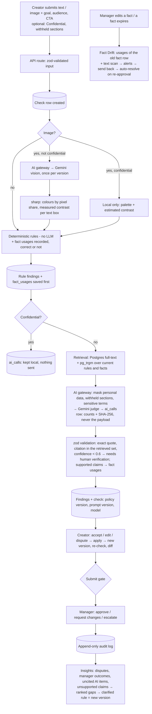

# Verity

**Pre-publication brand-compliance gate.** A brand stores its source of truth once: versioned rules, a Fact Registry and its visual identity. Verity checks every draft (text and images) against that source before it goes live. Every issue cites the rule or fact it breaks and comes with a suggested fix. A creator decides on each issue, and a manager approves. After approval, Verity keeps watching: when a fact changes, it finds the published content that is now wrong.

> **No source, no hard flag.** If the AI can't cite a rule or fact that was actually retrieved for this check, or isn't confident, the finding is downgraded to `needs_human_verification` and capped at medium severity.

- **Live demo:** https://getverity.xyz (no sign-in needed; same deployment also at https://verity-eight-lemon.vercel.app)
- **Code:** https://github.com/notaditya28/verity-
- **Demo brand:** "Lumina Skin", a fictional Indian skincare brand. Seeded history is fictional and labelled "Demo history (fictional)".
- Built for CodeZen India 2026 by team codzilla (solo). Round 3 improvements: see [IMPROVEMENTS.md](IMPROVEMENTS.md).

## 3-minute judge walkthrough
The home page has a **Start here** panel with these three paths; each switches to the right role for you.

1. **Check a post (Creator, ~1 min).** Submit → sample **1. Hype influencer post** → Check content. Every finding cites a rule (e.g. `C-03`) and a fact (`F-12: ₹449`) with a fix. **Accept all fixes → Apply → v2** comes back clean with a diff → **Submit for review** → switch to **Manager** → Review → **Approve**.
2. **Fact Drift (Manager, ~1 min).** Brand → **Change F-12 to ₹499** (a real edit). An approved post still says ₹449: the header shows **Drift · 1**. Open **Drift** → **Send back for update**. The creator sees the normal `C-03` finding with the ₹499 fix → Apply → Submit → Approve → the alert shows **Resolved**.
3. **Guideline insights + AI log (~1 min).** **Insights** ranks the rule creators keep disputing (T-02 on festival greetings, managers approving anyway) with its evidence → **Draft a clarification** (AI) → **Accept** creates a new rule version that the next check uses. Then open **AI log**: every AI call with characters sent and items masked — and the confidential draft "Project Aurora launch teaser", checked with nothing sent.

**Reset demo** in the header restores all seed data (including the drift posts, demo history and confidential example) at any time.

## Pages
| Page | What it shows |
|---|---|
| `/submit` | Draft form, 7 one-click samples, **Confidential** toggle, `[[confidential]] … [[/confidential]]` withheld sections |
| `/submissions/[id]` | Highlights, cited findings and fixes, accept / edit / dispute, version diff, image read-out, **Fact Drift banner**, **AI disclosure** panel |
| `/review` | Manager queue |
| `/brand` | Rules (with version history and "disputed in N of M" hints), Fact Registry (history, edit, **Try Fact Drift**), sensitive terms, palette |
| `/drift` | Fact Drift alerts grouped by fact: old → new value, matched text in context, send back / dismiss, filters |
| `/insights` | KPIs, ranked guideline gaps with evidence, AI clarification drafts, repeated mistakes by channel |
| `/ai-log` | Every third-party AI call: purpose, model, characters, items masked, status, SHA-256 of the payload |
| `/audit` | Append-only audit log |

## How a check works


If Gemini is down or slow, the rule findings are already saved; a backup model is tried once on 429/503, otherwise the check is marked *partial* and the page offers **Retry AI checks**.

## Architecture
- **One Next.js 15 app (App Router)** on Vercel. Server components for pages, route handlers for the workflow. No queues, workers or separate backend.
- **Postgres on Supabase** via Drizzle ORM. Round 2 tables plus Round 3: `fact_usages`, `drift_alerts`, `ai_calls`, `sensitive_terms`, and versioned `rules` (`current`). All Round 3 schema changes were additive.
- **One AI gateway** (`lib/ai/gateway.ts`): the only code that calls Gemini. It refuses confidential content, sanitises the whole prompt (`lib/ai/sanitize.ts`) and logs every call to `ai_calls`.
- **Retrieval**: Postgres full-text (`ts_rank`) + `pg_trgm` behind a `Retriever` interface (pgvector can slot in).
- **LLM**: `GEMINI_MODEL` (default `gemini-3.5-flash-lite`) with `GEMINI_FALLBACK_MODEL` (`gemini-3.1-flash-lite`), temperature 0, JSON schema.
- **Roles without login**: a Creator / Manager switcher (cookie), enforced on the server for every action.

| Path | What it does |
|---|---|
| `lib/checks/deterministic.ts` | Rule engine; records fact usages (pure, unit-tested) |
| `lib/checks/run.ts` | Orchestrates one check: image stage, rules, usages, AI stage, audit |
| `lib/drift/*` | Value matching (pure), drift detection / expiry / resolution, queries |
| `lib/insights/*` | Gap ranking and pg_trgm-compatible similarity (pure), SQL loaders |
| `lib/ai/*` | Gateway, sanitiser, Gemini client, AI-log queries |
| `lib/facts.ts`, `lib/rules.ts` | Versioned fact and rule edits (new policy version each time) |
| `lib/images/*`, `lib/checks/image-checks.ts` | Pixel analysis, CIEDE2000, WCAG contrast, alt text |
| `app/api/*` | All endpoints (zod on every input, role checked on the server) |
| `lib/demo/*` | Fictional seed data, demo history and samples |

## Run it locally
You need Node 20+, a Supabase project and a Gemini API key.
```bash
cp .env.example .env.local   # DATABASE_URL, DIRECT_DATABASE_URL, GEMINI_API_KEY, GEMINI_MODEL, GEMINI_FALLBACK_MODEL
npm install
npm run db:push              # create / update the tables (additive)
npm run seed                 # load the Lumina Skin demo org
npm run dev                  # http://localhost:3000
```

| Script | Purpose |
|---|---|
| `npm run typecheck` / `lint` / `build` | Quality gates (all pass before every push) |
| `npm test` | Offline tests: AI-output validation, fixes and diff, images, drift matching, insights ranking, confidential mode (AI client intercepted) |
| `npm run eval -- --ai --drift --insights` | Writes [EVAL.md](EVAL.md): rules, images, Gemini, drift scenarios, confidential checks, insights ranking |

## Environment variables
| Name | Use |
|---|---|
| `DATABASE_URL` | Supabase transaction pooler (port 6543), used at runtime |
| `DIRECT_DATABASE_URL` | Supabase session pooler (port 5432), used by `db:push` and `seed` |
| `GEMINI_API_KEY` | Google AI Studio key, server-side only |
| `GEMINI_MODEL` | e.g. `gemini-3.5-flash-lite` |
| `GEMINI_FALLBACK_MODEL` | Optional, e.g. `gemini-3.1-flash-lite`; used once when the main model answers 429/503 |

## Quality and safety
- TypeScript strict; zod on every API input and every LLM output.
- Every external AI call goes through one gateway: personal data, `[[confidential]]` sections and sensitive terms are masked first; confidential submissions never reach it. The log stores counts and a SHA-256, never content.
- Content is untrusted in prompts (delimited, tag-like text neutralised, strict JSON schema).
- Every check stores its policy, prompt and model version; every action is audit-logged.

## More documents
[IMPROVEMENTS.md](IMPROVEMENTS.md) · [TESTING.md](TESTING.md) · [EVAL.md](EVAL.md) · [FEATURES.md](FEATURES.md) · [CHANGES_FROM_PLAN.md](CHANGES_FROM_PLAN.md) · [DISCLOSURES.md](DISCLOSURES.md) · [CONTRIBUTIONS.md](CONTRIBUTIONS.md)
